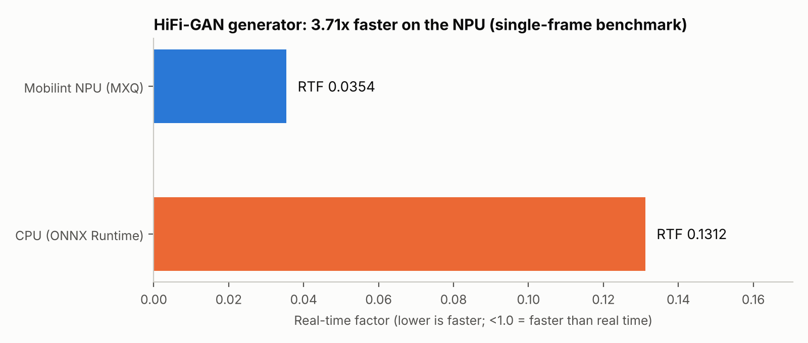
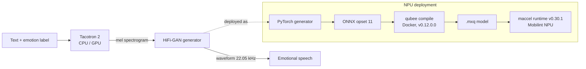

# Emotional TTS on the Mobilint NPU

Emotion-conditioned text-to-speech (Tacotron 2 + HiFi-GAN) with the HiFi-GAN vocoder compiled to the **Mobilint NPU** and benchmarked against CPU inference.

Course project for **DATA 255 (Deep Learning)**, group project (6 students). The NPU deployment work was presented to the Mobilint team.



| Metric | Value |
|---|---|
| Model on NPU | HiFi-GAN generator (neutral emotion baked in) |
| NPU real-time factor (RTF) | **0.0354** |
| CPU real-time factor (RTF) | 0.1312 |
| Speedup | **3.71x** |
| Operator support | 100% of ops supported by the toolchain |
| Runtime | Mobilint `maccel` v0.30.1 |

RTF = inference time / audio duration. Below 1.0 is faster than real time. Raw output: [`results/npu_benchmark_results.txt`](results/npu_benchmark_results.txt).

## Pipeline



## Model overview

- **Tacotron 2** (~28.7M parameters): character embedding, 3-layer conv encoder, BiLSTM, location-sensitive attention, autoregressive decoder, postnet. The emotion embedding is concatenated at every decoder step.
- **HiFi-GAN** (~64.9M parameters in total: generator 6.8M, MPD 41.9M, MSD 16.1M): transposed-convolution upsampling with multi-receptive-field blocks. Emotion is injected through affine layers. Trained with adversarial, feature-matching and L1 mel losses.
- **Data:** RAVDESS, 1,440 clips, 8 emotions, 24 actors. Check the dataset licence before reusing the data or generated audio.

## Why only the vocoder is on the NPU

Tacotron 2's attention-based autoregressive decoder is dynamic and does not map cleanly to a static NPU graph, so it stays on CPU/GPU. The HiFi-GAN generator is a feed-forward convolutional network, which suits ahead-of-time compilation to the NPU.

## NPU details

| Item | Value |
|---|---|
| Compiler | Mobilint `qubee` v0.12.0.0 (run in Docker) |
| Input format | ONNX, opset 11 |
| MXQ input | `mel`, shape `(1, 1, 1, 80)`, NHWC float32 |
| MXQ output | `audio`, shape `(1, 1, 256, 1)`, NHWC float32 |
| Sample rate | 22,050 Hz, 80 mel bins |
| Benchmark protocol | 3 warm-up runs, 10 timed runs |

## Read the numbers carefully

These caveats are part of the result, not footnotes:

- **Single-frame benchmark.** The timed input is one mel frame, not a full utterance. The 3.71x figure compares NPU and CPU on that workload only.
- **Neutral emotion baked in.** For compilation the emotion input was removed and the neutral embedding fixed as a constant, so the NPU model does not switch emotions at run time.
- **Per-emotion RTFs are repeated runs.** The results file lists RTF per emotion, but each loop reuses the same mel input and the same neutral model, so those values reflect run-to-run variation, not emotion-conditioned synthesis. They are not charted here for that reason.
- **Training limits.** HiFi-GAN training showed mode collapse after roughly 12-13 hours on an L4 GPU. Mitigations considered were lower learning rate, lower mel-loss weight, gradient clipping, discriminator warm-up and adding CREMA-D.
- **No quality metrics reported yet.** Targets from the course (MCD < 8 dB, PESQ > 2.5, STOI > 0.75, SER accuracy > 60%) are not claimed here.

## Repository layout

```
assets/                 charts used in this README
results/                raw benchmark output
tools/make_chart.py     regenerates assets/rtf_comparison.png from the results file
```

The NPU scripts are in [`scripts/`](scripts): `compile_to_mxq.py` (qubee compile, first two-input version) and `npu_inference.py` (benchmark and WAV output). Both need Mobilint's toolchain and an NPU, and they were rebuilt from the originals in my course Drive, so whitespace may differ from the originals.

Regenerate the chart:

```bash
pip install matplotlib
python tools/make_chart.py
```

## Team

Group 6, DATA 255 Deep Learning, San Jose State University. Team members are credited in the course submission.
